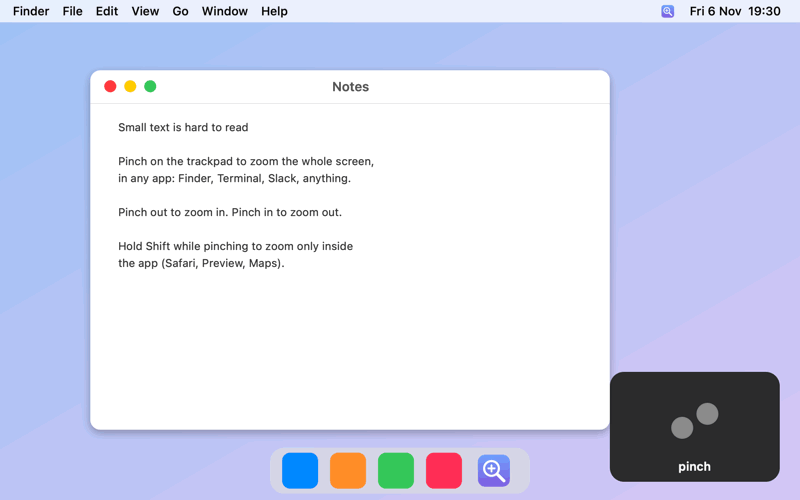

<p align="center"></p>

# PinchZoom

Two-finger pinch anywhere → whole-screen zoom, everywhere.

<p align="center"></p>

<sub>Animated illustration. macOS screen recordings can't capture Accessibility Zoom, so this is a rendered demo.</sub>

## What it does

PinchZoom watches for two-finger pinches anywhere and sends macOS's own
Accessibility Zoom shortcuts: pinch out = Cmd+Option+= (zoom in), pinch in =
Cmd+Option+- (zoom out). The whole screen zooms, in any app.

Hold **Shift** while pinching to skip the screen zoom, so the app's own pinch
zoom (Safari, Preview, Maps) works as usual.

Faking Option/Control + scroll does not work: macOS Zoom ignores synthetic
scroll events. The keyboard shortcuts are accepted.

## Requirements

- System Settings → Accessibility → Zoom → **Use keyboard shortcuts to zoom** ON.
- System Settings → Privacy & Security → **Accessibility** → PinchZoom ON.
  Grant it once. Builds are signed with a fixed certificate, so the
  permission survives updates (see [SIGNING.md](SIGNING.md)).

## Install

Download `PinchZoom.app.zip` from
[Releases](https://github.com/puchkoff/pinch-zoom/releases), unzip it, move
`PinchZoom.app` to `/Applications`, then run
`xattr -dr com.apple.quarantine /Applications/PinchZoom.app`.

Or build from source:

```bash
scripts/build-app.sh
ditto dist/PinchZoom.app /Applications/PinchZoom.app
open /Applications/PinchZoom.app
```

## Configure

- Sensitivity: `PINCHZOOM_STEP` env var, pinch amount per zoom step (default `0.08`, smaller = faster).
- Toggle / quit: menu-bar icon. The app also shows in the Dock.
- About: menu-bar icon → *About PinchZoom* shows the version and the
  Shift + pinch tip.
- Log: `~/Library/Logs/PinchZoom.log`.

## Known limitations

- Zoom moves in steps (one shortcut press each), not perfectly smooth.
- Apps with their own pinch (Safari, Preview, Maps) zoom their content too.
  Hold Shift to zoom only the app.

## Releases

`scripts/release.sh 1.2.0` builds, signs, tags, and publishes a release.
See [SIGNING.md](SIGNING.md).

## License

MIT
